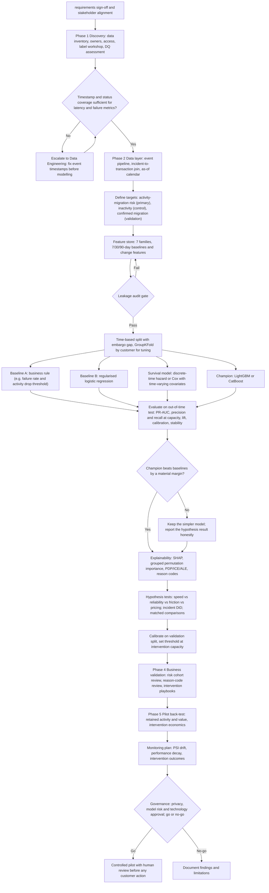

# Customer Fintech Migration Early-Warning Model: Project Guide

Source: internal requirements for a controlled pilot (synthetic-data version of the project).

---

## 1. Flowchart: end-to-end process

---

## 2. Leakage: what to check and where this project is exposed

### 2a. Checklist (apply to every feature and label)

| # | Check | Why it matters here | How to test |
|---|---|---|---|
| 1 | **As-of date discipline.** Every feature for a customer at date *t* uses only events with timestamps ≤ *t*. | requirements 6.2 requires this. Rolling features and "current month" aggregates are the most common slip. | Recompute features with data truncated at *t*. Values must not change. |
| 2 | **Label window separated from feature window.** | The label is the next 30/60/90 days. Any feature that peeks into that window leaks. | Assert `max(feature_event_time) < prediction_date` in the feature store. |
| 3 | **Target-proxy features.** Features that observe the migration itself are not predictors. | Fintech outflows, wallet spend and external balances are close to the outcome. | Single-feature AUC scan (see 2b). Keep proxies out of the primary model. |
| 4 | **Post-outcome fields.** | Churn date, exit reason, churn type and survival fields are known only after the outcome. | Column allow-list. Anything not on it is rejected in CI. |
| 5 | **Survey and CX timing.** CSAT, NPS, declared primary bank and complaint resolution may be collected or closed after the customer has already moved. | Sparse survey responses can be sent more often to customers who are already leaving. | Use the survey response timestamp, not the month. Check missingness against the label. |
| 6 | **Bureau refresh lag.** Bureau data arrives quarterly. | Using the month-end value before the refresh date is leakage. | Join on the bureau pull date with a lag. |
| 7 | **Preprocessing fitted on all data.** Imputers, scalers, encoders and target encoders fitted before the split. | Inflates test scores quietly. | Put preprocessing inside the pipeline, fitted on train only. |
| 8 | **Random splits on panel data.** The same customer appears in train and test. | Customer identity leaks through stable traits. | Time-based split and GroupKFold by `customer_id`. |
| 9 | **Survivorship.** Customers who left stop producing rows. | Features such as "days since last login" and "last month active" can encode the exit. | Compare feature distributions at the last observed month with those in the middle of life. |
| 10 | **Backfilled incidents.** Incident end times and severities are often corrected after the fact. | Post-hoc severity makes exposure look more predictive than it was. | Use the incident status history as it stood at each date. |
| 11 | **Peer and aggregate features.** Location-level adoption computed over the full period, including future adopters. | Uses future information. | Compute aggregates with a lag, using only data available at *t*. |
| 12 | **Label definition overlaps the features.** For example, an "activity migration" label built from transaction drops, with a feature that is itself a transaction drop over the same window. | Circular. | Ensure baseline windows do not overlap the label window. |
| 13 | **Missingness that encodes the outcome.** | Missing NPS may mean the customer was surveyed as part of exit handling. | Add missing-indicator AUC to the leakage report. |

### 2b. Results from the synthetic dataset (single-feature AUC on the test split, 3-month label)

Run with `src/leakage_scan.py`:

| Column | Standalone AUC | Verdict |
|---|---|---|
| `third_party_wallet_spend_share` | **0.877** | **Leakage / generator defect.** The generator tied wallet share to the pre-churn decay and to fintech adoption, which are the target itself. Excluded from the primary model. Fix before reuse. |
| `fintech_outflow_share_chg3` | 0.791 | **Target-proxy.** Observes migration already under way. |
| `fintech_outflow_share` | 0.786 | Target-proxy. |
| `avg_balance_trend3` | 0.735 | Plausible leading indicator, but the generator makes it steep during decay. Check realism. |
| `fintech_outflow_share_roll3`, `fintech_outflow_count`, `fintech_outflow_amount` | 0.64 to 0.74 | Target-proxy family. |
| `merchant_settlement_share_other_psp` | 0.73 | SME-only. Plausible, but check whether it is observed only after the event. |
| `nps_score`, `csat_score` | 0.69 / 0.61 | Sparse, timing unknown. Check item 5 before use. |

**Correction to my earlier summary.** I said the fintech-flow indicators matter most. That was misleading. Removing these features drops AUC from 0.920 to 0.833, which measures how much the model depends on proxies of the outcome, not whether fintech migration causes churn. Do not present that result as evidence for the hypothesis.

**Other synthetic-data caveat.** Because the generator simulates a pre-churn decay, the signal is cleaner than real data will be. Expect lower AUC on real data. Treat the baseline numbers as a pipeline check only.

---

## 3. Recommended models

| Role | Model | Why | When to use |
|---|---|---|---|
| **Business baseline (required)** | Rule set: failure rate above threshold and balance or activity drop over 30 days | requirements acceptance criterion: lift over a simple business baseline. | Always. |
| **Interpretable baseline** | Logistic regression (L2, or elastic net) on standardised features and change features | Coefficients are auditable and easy to explain to model risk. | Always. |
| **Survival / hazard** | Discrete-time hazard: logistic regression or GBM on person-period data with a time index. Alternatively Cox with time-varying covariates (`lifelines` `CoxTimeVaryingFitter`). | Matches "when is this customer about to leave" and the 30/60/90-day horizons. | Strongly recommended, since the requirements asks for 30/60/90-day scores. |
| **Champion (non-linear)** | LightGBM, or CatBoost if many categoricals | Strong on tabular data, handles missing values, fast. CatBoost handles high-cardinality categoricals (occupation, location) without leakage-prone target encoding. | Only if it beats the logistic model by a material PR-AUC margin on out-of-time data (requirements section 10). |
| **Calibration** | Isotonic or Platt, fitted on the validation split only | Probabilities drive intervention ROI. | After choosing the champion. |
| **Optional, later** | Random survival forest (`scikit-survival`) or ensemble of hazard and GBM | Only if the hazard model is clearly limited. | Not for the pilot. |

Avoid deep learning for this data size and governance context. It adds opacity without a clear gain.

---

## 4. Explainability: what to compute and what each result tells you

Set up one explainability notebook. Run it on the champion, the logistic baseline and the hazard model, so the explanations can be compared.

### 4a. Global importance

1. **SHAP summary (beeswarm) and mean |SHAP| bar chart.** Use `shap.TreeExplainer` for LightGBM or CatBoost. Use `LinearExplainer` for logistic regression. Show which features drive risk and in which direction.
2. **Grouped permutation importance by feature family.** Permute all speed features together, then all reliability features, and so on. Use the out-of-time test set. Correlated features split importance when permuted one at a time. Grouped permutation answers the requirements question "does speed matter beyond reliability?" more directly. Use `sklearn.inspection.permutation_importance` with a custom grouped permutation.
3. **Drop-group retraining.** Retrain without each family and measure the change in PR-AUC. Permutation importance is cheaper, but retraining is the more honest test of whether a family adds information.

### 4b. Effect shape

4. **Partial dependence plots (PDP).** Show the average effect of `latency_p95_roll3`, `failure_rate_roll3`, `fintech_outflow_share_roll3`, `avg_balance_trend3` and `app_logins_trend3`. Look for thresholds, plateaus and non-monotonic effects.
5. **ICE curves on top of PDP.** Individual curves reveal heterogeneity. If the average is flat but individual curves slope, speed matters for some customers only.
6. **ALE plots instead of PDP where features are correlated.** PDP evaluates impossible combinations, such as high volume with zero transactions, when features are correlated. ALE avoids this. Use the `PyALE` package.
7. **Two-way PDP or SHAP interaction values.** Test whether speed matters more for high-value or high-volume customers. This directly tests the requirements's "friction construct" idea.

### 4c. Customer-level reason codes

8. **Top-3 SHAP contributions per high-risk customer.** Map each feature to plain language (for example, "Repeated failed transfers in the last 30 days"). requirements O2 and FR-02 require this.
9. **Validate reason codes.** Check that they are not just high volume in disguise. Compare the top reasons with the customer's actual transaction history for a sample of 50 customers, reviewed with Digital and CX.
10. **Stability of reason codes over time.** If the top reason changes every month, the explanations are not reliable enough to act on.

### 4d. Hypothesis evidence

11. **SHAP family contributions.** Sum the SHAP values within each family to get a per-customer share. Report the speed family's share against the reliability and friction families.
12. **Segment-level SHAP.** Run the same analysis for retail, SME and each age band. The requirements requires segment stability testing.
13. **Causal checks, which SHAP cannot provide.** SHAP explains the model, not causes. Test causality with incident difference-in-differences around `outage_incidents.csv`, and with matched comparisons on failure exposure, using `customer_id`-level matching on volume, balance and tenure. Use the `ground_truth_oracle` file in the synthetic data to check that your estimator recovers the true speed effect.

### 4e. Caveats to state in the report

- Correlated features make SHAP and permutation importance split credit. Say so when the top feature is one of a correlated pair.
- Explanations describe the model's behaviour. They do not establish that fixing latency will stop migration.
- Reason codes must be reviewed by a human before any customer action (requirements section 13).

---

## 5. Project walkthrough: start to finish

Timing below assumes the requirements's 5-period roadmap. Adjust the durations to the pilot's actual length. The 90-day pilot window is the constraint to plan against.

### Phase 1: Discovery (roadmap period 1)

1. **Data inventory.** For each row of requirements section 7, record the source system, the owner, the access route and the refresh frequency. Start with `data_dictionary.csv` as a template. Replace its "real-world source" column with the confirmed system and owner.
2. **Label workshop.** Agree the three outcomes in requirements section 6.1 with Product, Retail and Model Risk. Write down the exact definition of "materially reduces activity": for example, a drop of at least 40% in transaction value over 30 days against the trailing 90-day baseline, for two consecutive months.
3. **Data-quality assessment.** Measure timestamp coverage: the share of transactions with both initiated and completed times, and the share with a final status. This decides whether the speed hypothesis is testable at all. requirements risk: incomplete timestamps.
4. **Incident taxonomy.** Standardise channel names and time windows across monitoring and incident tools, so incidents join cleanly to transactions.

**Exit criterion:** signed data dictionary, source owners named, label definition approved, go or no-go on timestamp quality.

### Phase 2: Data layer (period 2)

5. **Event table.** One row per transaction, with customer, channel, type, amount, initiated time, completed time, status, failure code, reversal, timeout and retry.
6. **Incident join.** Map each transaction to any incident on its channel and location at its initiation time. Derive `outage_minutes_exposed` and the count of exposed transactions. Keep bank-wide incidents separate from customer-specific friction, as requirements section 8 requires.
7. **Customer-period panel.** One row per customer per week or month. Keep only rows where the customer is still active, as in the synthetic panel. Weekly is better if you want 30-day windows to line up with the requirements.
8. **Feature store.** Build the seven families from requirements section 9, plus 7/30/90-day baselines and change features. Write an as-of test for every feature, following section 2a.
9. **Leakage gate.** Run the single-feature scan, the proxy check and the as-of tests. Do not move to modelling until the gate passes. Record every excluded feature and why.

**Exit criterion:** feature store with as-of tests passing, leakage report signed off, at least 12 months of history where the source allows.

### Phase 3: Modelling (period 3)

10. **Time-based split.** For example, train on months 1 to 9, validate on 10 to 11 and test on 12. Leave an embargo gap equal to the longest horizon between the last training label and the first validation feature.
11. **Build the baselines first.** Business rule, then logistic regression. Record PR-AUC, precision and recall at capacity, and calibration for each. The champion must beat these.
12. **Build the hazard model and the champion.** Tune LightGBM or CatBoost with GroupKFold by customer inside the training period only. Evaluate once on the out-of-time test set.
13. **Evaluate for the requirements's metrics.** PR-AUC, precision and recall at the intervention capacity, calibration curve and Brier score, lift by decile, stability across segments and months (PSI).
14. **Run the explainability notebook** from section 4 on the champion. Produce reason codes for a sample.
15. **Test the hypotheses.** Compare model variants: speed only, reliability only, speed plus reliability, friction, pricing, and the combined friction construct. Run the incident difference-in-differences test. Report every hypothesis, including the ones that fail.

**Exit criterion:** champion or baseline chosen on evidence, calibrated, explained, with hypothesis results documented.

### Phase 4: Business validation (period 4)

16. **Cohort review.** Walk through the high-risk cohorts with Retail, Digital, CX and Branch/RM. Check that reason codes make sense to them.
17. **Intervention design.** For each reason code, write a playbook: owner, action, expected outcome, and how it will be measured. requirements risk: no intervention owner.
18. **Capacity and threshold.** Set the threshold so the number of flagged customers matches what the teams can contact. Model the false-positive cost, including customer fatigue.

**Exit criterion:** named owner and playbook for each top reason code, agreed threshold.

### Phase 5: Pilot decision (period 5)

19. **Back-test value.** Estimate retained activity and value for the flagged cohort against a matched control. Use the intervention economics from step 18.
20. **Monitoring plan.** PSI on key features, weekly performance on newly matured labels, calibration drift, and intervention outcome tracking.
21. **Acceptance criteria check.** Work through requirements section 17 item by item, with evidence for each.
22. **Recommendation.** Go, extend the pilot, or stop. State limitations and known biases, as requirements section 13 requires.

---

## 6. Acceptance criteria mapping (requirements section 17)

| Criterion | Evidence to produce |
|---|---|
| Approved data dictionary and owners | Signed `data_dictionary.csv` |
| 12+ months of history | Date coverage report |
| Timestamp and status coverage | Coverage table by channel and month |
| Documented target, no material leakage | Label definition and the leakage report (section 2) |
| Lift over simple baseline | Table: rule, logistic, hazard, champion, PR-AUC and precision at capacity |
| Interpretable, actionable drivers | Reason-code review with business owners |
| Stable across segments and time | Segment and monthly metric tables, PSI |
| Quantified value case | Back-test with matched control and intervention economics |

---

## 7. Risks to watch (requirements section 16)

- **No confirmed migration label.** Do not claim a fintech destination. Report "activity-migration risk" and use consented or research samples for validation only.
- **Proxy dependence.** A model that scores well only on fintech-outflow features is measuring migration already under way. Report it that way.
- **Alert fatigue.** Calibrate and set thresholds at capacity, not at a fixed probability.

---

## 8. Known issues in the synthetic dataset (fix before reuse)

1. `third_party_wallet_spend_share` leaks (single-feature AUC 0.88). Remove the dependence on the decay term and on `has_fin2`.
2. Fintech-outflow features are too strongly tied to the decay. Reduce the share of the decay that flows into them.
3. Labels are 1/3/6 months. The requirements asks for 30/60/90 days. Regenerate on a weekly grain, or convert horizons to 1, 2 and 3 months and say so.
4. The 12-month history requirement is met (24 months), but the dataset has no weekly grain.
5. Survey fields are random samples rather than event-driven. Real surveys will be event-driven, which changes their missingness pattern.

Fix these in the generator, rerun `src/leakage_scan.py`, and confirm the top single-feature AUC falls below about 0.75 before the dataset is used for model comparison.
